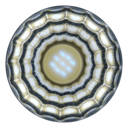
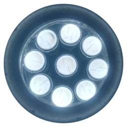
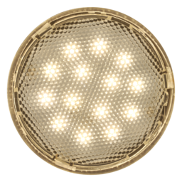

# ambientCG: HDRI elements

**4 assets from [ambientCG](https://ambientcg.com), dedicated to the public domain under [CC0](https://docs.ambientcg.com/license/).** Use them in any game, free or paid, and change them however you like; no credit is needed.

HDRI elements (single objects lit for compositing) at 1K and 2K. 27.8 MB in all.

This is a copy kept by [zuujis-cc0](https://github.com/zuujis-cc0) so game makers can take single files from GitHub. It is not made by or affiliated with ambientCG: the originals, often in more formats and higher resolutions, are on [ambientcg.com](https://ambientcg.com). If they help you, consider [supporting ambientCG](https://www.patreon.com/ambientCG).

Every file is listed in [MANIFEST.tsv](MANIFEST.tsv) with its size and SHA-256. More free assets: [the Zuujis collection](https://github.com/zuujis-cc0/free-game-assets#readme).

| | | | |
| :-: | :-: | :-: | :-: |
|  <b><a href="HDRIElement001">HDRI Element 001</a></b> by ambientCG · <a href="https://ambientcg.com/a/HDRIElement001">source</a> |  <b><a href="HDRIElement002">HDRI Element 002</a></b> by ambientCG · <a href="https://ambientcg.com/a/HDRIElement002">source</a> |  <b><a href="HDRIElement003">HDRI Element 003</a></b> by ambientCG · <a href="https://ambientcg.com/a/HDRIElement003">source</a> |  <b><a href="HDRIElement004">HDRI Element 004</a></b> by ambientCG · <a href="https://ambientcg.com/a/HDRIElement004">source</a> |

---

Kept up to date by this repository's own [update workflow](.github/workflows/update.yml), with code and plan from [cc0-mirror](https://github.com/zuujis-cc0/cc0-mirror). Something wrong? [Open an issue there](https://github.com/zuujis-cc0/cc0-mirror/issues/new) or use the [private report form](https://games.zuujis.com/report).
